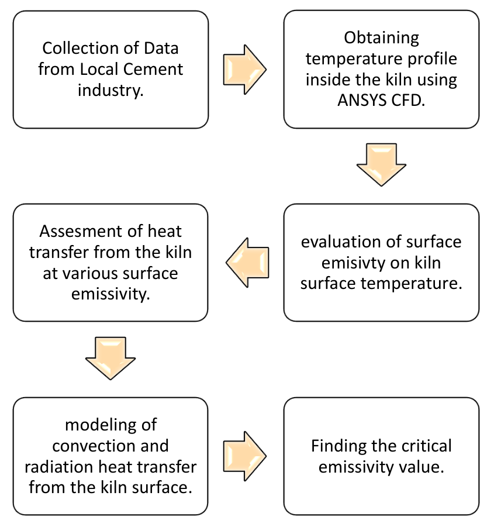
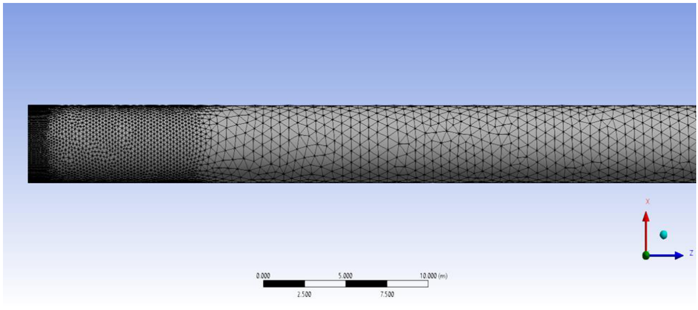
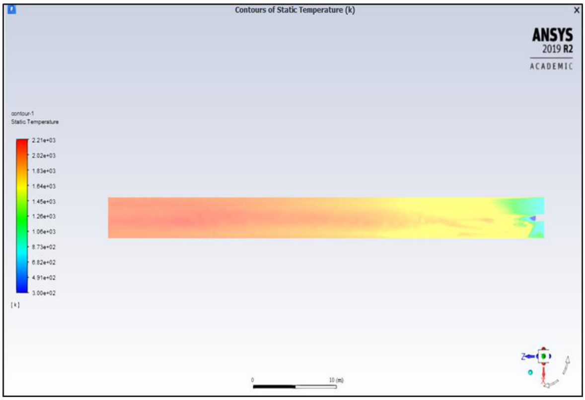
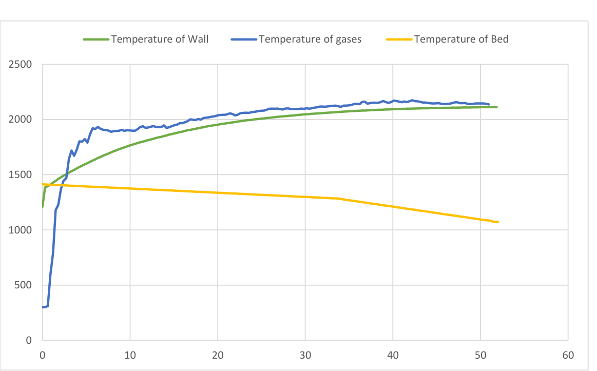
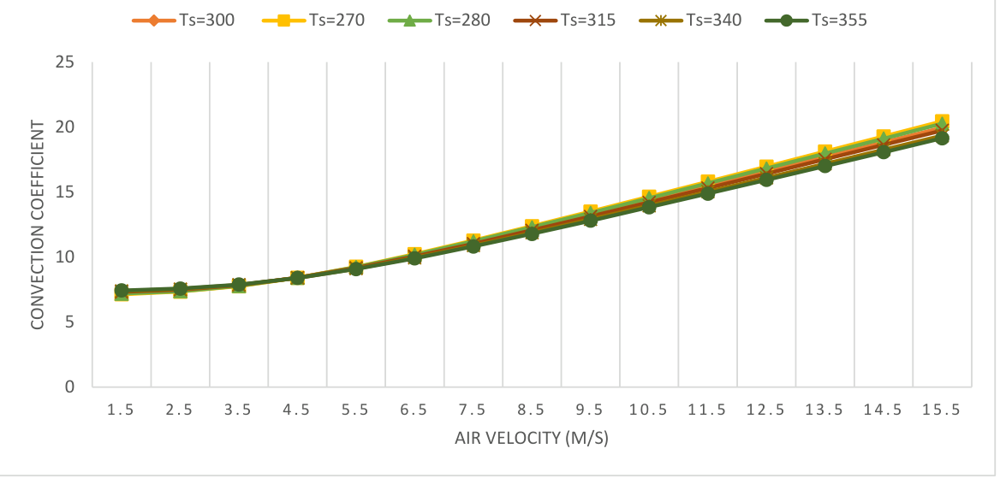
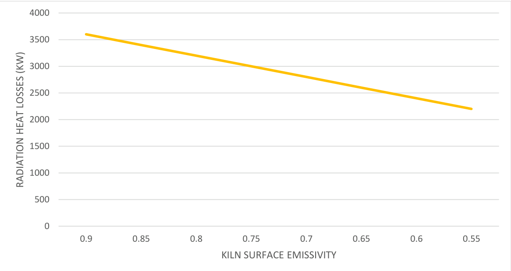
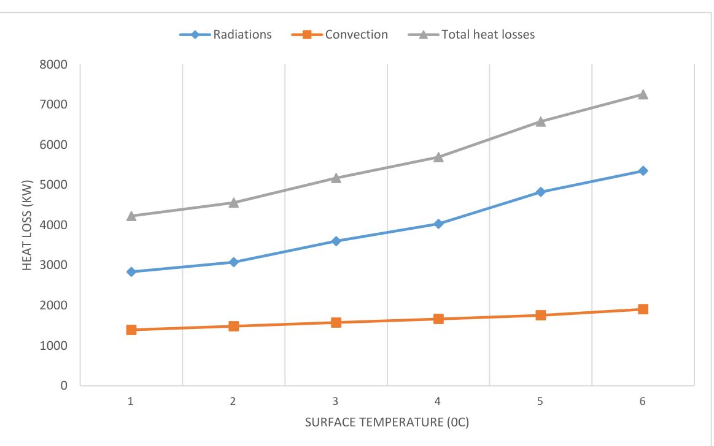
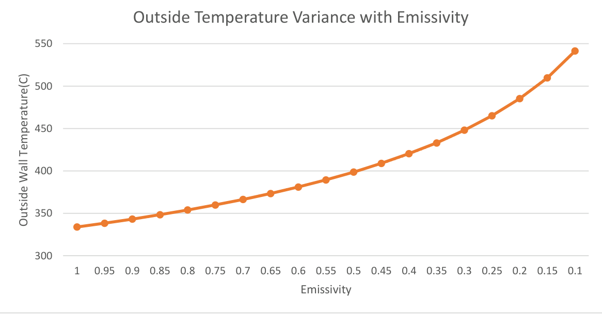

# Investigation and Reduction of Radiation Heat Losses from a Rotary Kiln by Using Low Emissivity Paint

**BSc Mechanical Engineering — final-year research summary**  
**University of Engineering and Technology (UET), Peshawar, Pakistan**  
**Case study:** Rotary kiln, Line 2, Cherat Cement Factory, Pakistan  
**Research paper authors (as listed in the original manuscript):** Habib Ullah Khan, Muhammad Alamzeb, Wilayat Said, Seemab Zahid and Arifain Muhammad

> **About this repository:** This is a documentation-only summary of our undergraduate rotary-kiln research, prepared from the available research manuscript. The eight figures below are taken directly from that manuscript, without recreating the plots or changing their data. The [original source document](source-study.pdf) is included for context. This repository does **not** contain an executable ANSYS model, raw industrial datasets or new simulation results.

## Research overview

A cement rotary kiln operates at high internal temperatures, and heat escapes through its external shell by both **thermal radiation** and **convection**. The work examined whether applying a **low-emissivity coating** to the outside of the kiln could reduce radiative losses while keeping the resulting shell-temperature increase within a proposed safe operating range.

The analysis combined **industrial operating information**, **computational fluid dynamics (CFD)**, **heat-transfer calculations** and **steady-state thermal modelling**. The specific case study considered an operating kiln at Cherat Cement Factory, with geometric and operating parameters recorded for Line 2.

## Study objectives

- Estimate heat loss from the kiln shell through radiation and convection.
- Model combustion and temperature distribution inside the rotary kiln.
- Assess the relationship between shell emissivity, shell temperature and total heat loss.
- Identify a candidate coating emissivity that offers energy savings without an excessive predicted increase in shell temperature.

## Data and operating conditions

The study used **factory-supplied / site-collected information** for the Cherat Cement rotary kiln, together with the modelling assumptions and heat-transfer inputs documented in the paper.

| Parameter | Value reported in the manuscript |
| --- | ---: |
| Kiln length | 52 m |
| Outer diameter | 4.4 m |
| Inner diameter | 4.0 m |
| Baseline average external-shell temperature | 300 °C |
| Ambient temperature used for external heat-loss estimates | 40 °C |
| Assumed baseline shell emissivity | 0.9 |
| Coal mass-flow rate in the CFD case | 1 kg/s |
| Total air-flow rate in the CFD case | 10.59 kg/s |
| Mixed-convection heat-transfer coefficient | 8.4 W/(m²·K) |

These values describe the **reported study configuration**, not a newly collected dataset. The original industrial data files are not included in this repository. As explained in the manuscript, the internal kiln temperature profile was estimated through CFD rather than measured with temperature sensors inside the kiln.

## Tools and methods

| Tool / technique | Purpose |
| --- | --- |
| **ANSYS SpaceClaim** | Create the simplified cylindrical kiln and burner geometry from the reported dimensions |
| **ANSYS Fluent** | Simulate turbulent flow, non-premixed coal combustion and internal gas/wall temperature distribution |
| **RNG k–ε turbulence model** | Represent turbulent flow inside the kiln |
| **P1 radiation model** | Account for radiative heat transfer within the CFD combustion model |
| **Heat-transfer correlations** | Estimate external convection and radiation losses, including mixed convection |
| **ANSYS Steady-State Thermal** | Examine changes in predicted external shell temperature for different surface-emissivity values |

The modelling approach described in the source document was:

1. Collect kiln geometry, burner and operating information from the cement plant.
2. Construct a simplified kiln geometry and refine the CFD mesh near the burner/combustion region.
3. Run a pressure-based, steady-state Fluent simulation with energy, turbulence, radiation and non-premixed species models. The manuscript describes **250 initial first-order iterations followed by 50 second-order iterations**.
4. Examine the resulting gas and internal-wall temperature profiles, and compare the simulated temperature ranges with industrial operating zones and published work.
5. Calculate external convective and radiative heat losses using the reported shell dimensions, shell temperature, ambient temperature and emissivity.
6. Use steady-state thermal analysis to examine how reducing emissivity changes the predicted outer-shell temperature. The study reports varying emissivity in steps of **0.05**.
7. Compare the predicted energy-saving benefit with the accompanying shell-temperature increase, and propose a practical emissivity value.

*Original Figure 1. Research workflow from the manuscript.*

## Original figures and observations

These are **the original figures from the source document**, exported as images directly from their PDF pages for display on GitHub. They have not been replotted or recalculated.

### 1. CFD mesh

*Original Figure 2. Mesh refinement near the burner tip, with a coarser mesh further along the kiln.*

### 2. Combustion temperature contour

*Original Figure 3. Gas-temperature contour along the kiln from the CFD analysis.*

### 3. Internal temperature profiles

*Original Figure 4. Wall, gas and bed temperature profiles for the reported fuel-flow case.*

### 4. Mixed-convection coefficient

*Original Figure 5. Mixed-convection coefficient at different air velocities and shell temperatures.*

### 5. Radiative heat loss and emissivity

*Original Figure 6. Modelled radiative heat loss against kiln-surface emissivity.*

### 6. Heat loss and shell temperature

*Original Figure 7. Radiative, convective and total heat losses across the temperatures plotted in the manuscript.*

### 7. Predicted outer-shell temperature and emissivity

*Original Figure 8. Predicted increase in kiln outer-wall temperature as surface emissivity decreases.*

## Results reported in the study

For the **52 m long, 4.4 m external-diameter kiln** at an average external-shell temperature of **300 °C** and baseline surface emissivity **0.9**, the manuscript reports:

| Metric | Reported result |
| --- | ---: |
| Baseline total external heat loss | Approximately **5,173 kW** |
| Radiation share of external losses | Approximately **70%** |
| Convection share of external losses | Approximately **30%** |
| Proposed lower-emissivity coating | **ε = 0.6** |
| Predicted increase in shell temperature at ε = 0.6 | Approximately **45 °C** |
| Predicted reduction in total external heat loss | Approximately **250 kW**, or **4.8%** |

The research therefore proposed **0.6 emissivity** as a compromise between reducing radiation losses and avoiding an excessive predicted increase in external shell temperature. The source discusses a roughly **50 °C allowable temperature increase** as a design consideration based on its cited background material; this should **not** be interpreted as field validation or a universal safety limit for industrial kilns.

The manuscript's abstract estimates the fuel equivalent of the 250 kW saving as **832 kg of coal per day**, while its discussion reports **about 890 kg/day**. Both figures are present in the source. This README preserves that distinction rather than silently changing or reconciling the original calculations.

## Scope and limitations

- This is a **modelling and heat-transfer assessment**, not documentation of a coating successfully installed and tested on an operating kiln.
- The kiln and combustion process were represented using simplifying assumptions, including steady-state conditions, incompressible flow and an idealized geometry.
- The study did not have internal-kiln temperature sensor measurements for direct validation; the manuscript describes comparisons with known temperature ranges and relevant literature.
- The predicted thermal effect depends on the assumed boundary conditions, material properties, convection correlations and emissivity.
- The paper discusses shell temperature and possible thermal-stress concerns, but no independent structural safety certification or industrial field trial is provided here.
- The original ANSYS project files, mesh files and underlying raw industrial inputs are **not included**, so the full simulations cannot be rerun from this documentation-only repository.

## Source and attribution

The research, data and figures summarized here are from the manuscript:

**Habib Ullah Khan, Muhammad Alamzeb, Wilayat Said, Seemab Zahid and Arifain Muhammad.** *Investigation and Reduction of Radiation Heat Losses from a Rotary Kiln by Using Low Emissivity Paint.* [Read the source PDF](source-study.pdf).

This README is an abbreviated presentation of the source research for a GitHub portfolio. It does not claim to be a new study, to reproduce the ANSYS calculations, or to include the full original undergraduate thesis document.
